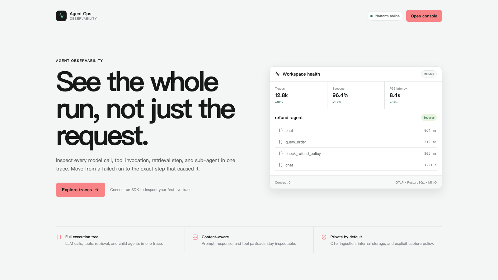
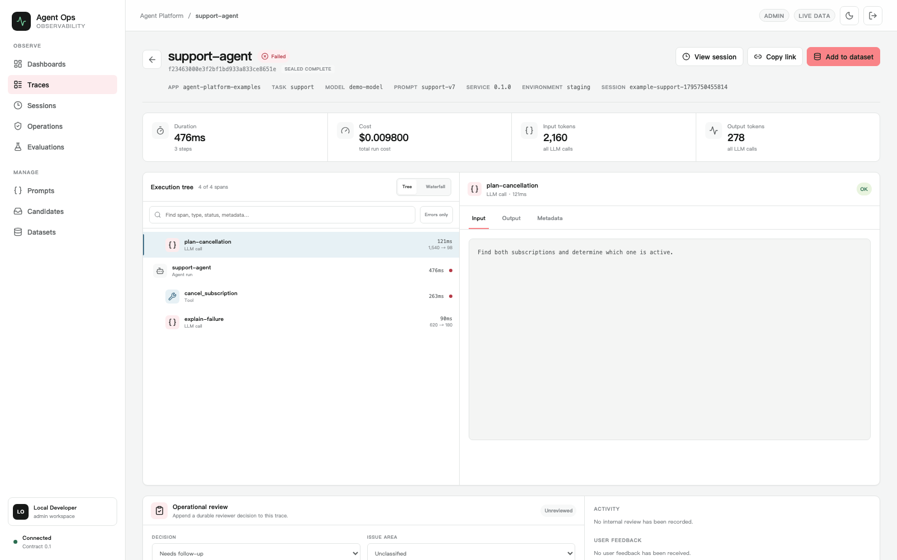
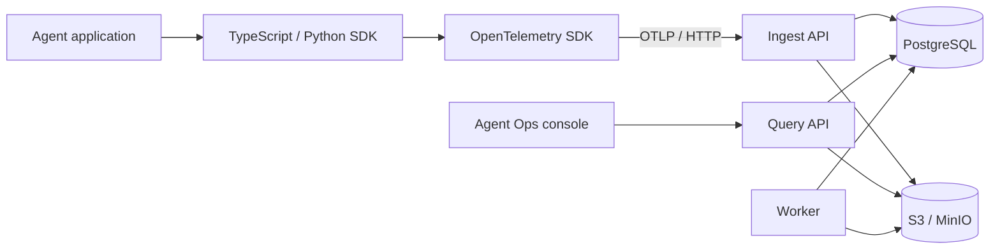

<div align="center">
  
</div>

<h1 align="center">Agent Ops</h1>

<p align="center">
  <strong>Self-hosted observability and evaluation for AI agents.</strong><br />
  Trace every run. Review the failure. Turn it into a dataset.<br />
  Prove the fix before the next release.
</p>

<p align="center">
  <a href="README.zh-CN.md">简体中文</a> ·
  <a href="#quick-start">Quick start</a> ·
  <a href="#architecture">Architecture</a> ·
  <a href="#documentation">Documentation</a>
</p>

<p align="center">
  <a href="https://github.com/DraskyChen/Agent-Ops/actions/workflows/ci.yml">
    
  </a>
  <a href="https://www.npmjs.com/package/agent-ops-otel-sdk">
    
  </a>
  <a href="https://pypi.org/project/agent-ops-otel-sdk/">
    
  </a>
  
  <a href="LICENSE">
    
  </a>
</p>

Agent Ops makes one complete agent run observable as a single trace: model
calls, tool invocations, retrieval steps, planning, and sub-agents. Start from
a failed or low-quality run, inspect the exact step, curate it into a dataset,
evaluate a change, and compare the regression before release.

```text
Observe  →  Review  →  Curate  →  Evaluate  →  Compare  →  Improve
```

## Why Agent Ops

**See the execution tree, not disconnected logs.** Follow an agent from its
root run through every LLM call, tool call, retrieval step, and child agent,
with timing, tokens, cost, status, and errors in context.

**Keep application and human trust boundaries separate.** SDKs authenticate
with machine credentials. The console uses OIDC, role-based access, explicit
content-viewing permission, access auditing, and retention controls.

**Close the loop from production to regression testing.** Use negative
feedback, unresolved reviews, runtime failures, and failed evaluations as
candidate data. Create immutable dataset revisions, run rules or an LLM Judge,
and compare two runs on the same revision.

**Start with open standards.** Both SDKs are thin wrappers over the official
OpenTelemetry SDKs and send OTLP over HTTP. PostgreSQL is the system of record;
MinIO or any S3-compatible store holds captured content.

<div align="center">
  
  <sub>A failed tool call stays connected to its parent run, cost, tokens, and captured input.</sub>
</div>

## Quick start

### Requirements

- Node.js 24+ and pnpm 12+
- Docker with Compose
- Python 3.11+ only if you are changing the Python SDK

```bash
git clone https://github.com/DraskyChen/Agent-Ops.git
cd Agent-Ops
cp .env.example .env

pnpm install
pnpm contracts:build
pnpm infra:up
pnpm db:migrate
pnpm metrics:backfill
pnpm dev
```

Open [http://localhost:3000/console](http://localhost:3000/console). Local
development uses `AGENT_OPS_AUTH_MODE=dev`; production requires OIDC.

If Docker uses a non-default context:

```bash
DOCKER_CONTEXT=orbstack pnpm infra:up
```

Want realistic data immediately? Run the included examples:

```bash
pnpm examples:ts
# or
pnpm examples:python
```

## Send your first trace

Install the TypeScript SDK:

```bash
npm install agent-ops-otel-sdk@0.1.0
```

```ts
import {
  configureTracing,
  shutdownTracing,
  withAgentRun,
  withLlmCall,
  withToolCall,
} from "agent-ops-otel-sdk";

await configureTracing({
  serviceName: "support-agent",
  serviceVersion: "1.4.0",
  appName: "customer-support",
  environment: "prod",
  endpoint: "https://agent-ops.example.com/v1/traces",
  headers: {
    authorization: `Bearer ${process.env.AGENT_OPS_INGEST_TOKEN}`,
  },
});

try {
  await withAgentRun(
    {
      sessionId: "session-123",
      taskType: "support",
      inputSummary: "Resolve a duplicate subscription",
    },
    async (run) => {
      await withLlmCall(
        {
          provider: "deepseek",
          requestModel: "deepseek-flash",
          inputTokens: 420,
          outputTokens: 80,
        },
        async () => "Call the subscription tool.",
      );

      await withToolCall(
        {
          name: "cancel_subscription",
          argsSummary: '{"subscriptionId":"sub-b"}',
        },
        async () => ({ cancelled: true }),
      );

      run.complete("success", "final_answer");
    },
  );
} finally {
  await shutdownTracing();
}
```

For full prompt and response capture, set `contentCapture: "full"` and provide
`contentToken`. See the [examples](examples/README.md) for success, tool
failure, retrieval, multi-agent, and DeepSeek runs.

## SDKs

Both SDKs expose the same `0.1` telemetry contract.

| Runtime | Install | Import | Release |
| --- | --- | --- | --- |
| TypeScript / Node.js 20+ | `npm install agent-ops-otel-sdk@0.1.0` | `agent-ops-otel-sdk` | [npm](https://www.npmjs.com/package/agent-ops-otel-sdk) |
| Python 3.11+ | `pip install agent-ops-otel-sdk==0.1.0` | `agent_ops` | [PyPI](https://pypi.org/project/agent-ops-otel-sdk/0.1.0/) |

The npm package is ESM-only. Both packages are verified on their minimum
runtime and published together under `sdk-v*` GitHub tags.

- [TypeScript SDK guide](packages/sdk-typescript/README.md)
- [Python SDK guide](packages/sdk-python/README.md)
- [SDK release and compatibility runbook](docs/sdk-release.md)

## What is included

| Observe | Improve | Operate |
| --- | --- | --- |
| Trace search, execution tree, waterfall, Span errors, Sessions | Candidate discovery and internal trace reviews | OIDC and viewer / reviewer / admin roles |
| Volume, status, cost, latency, tool-error dashboards | Immutable datasets, rule evaluation, DeepSeek LLM Judge | Content permissions, access audit, retention cleanup |
| Complete captured content and shareable Trace links | Two-run comparison with per-case deltas | PostgreSQL and MinIO backups plus restore drill |
| Prompt Registry with lifecycle and audit history | Evaluator templates and configuration replay | Single-team production Compose and migrations |

## Architecture



The first deployment is a modular monolith with three processes: `web`,
`server`, and `worker`. PostgreSQL is the initial system of record; the
persistence boundary allows trace storage to move later if measured query
volume requires it. Ingest and query also stay separate modules with distinct
trust boundaries.

Read [Architecture](docs/architecture.md) and
[Code Architecture](docs/code-architecture.md) for the design decisions and
enforced module boundaries.

### Production Compose

```bash
cp .env.production.example .env.production

pnpm release:config
pnpm release:build
pnpm release:up
```

The `migrate` service runs before Server and Worker. Web listens on
`http://127.0.0.1:8080` by default; the MinIO console is bound to local port
`9001`. See the [release runbook](docs/release-runbook.md) before deploying.

## Project status

Agent Ops is **0.1 alpha / pre-production**. The core trace-to-evaluation
vertical slice is implemented and exercised against real PostgreSQL and MinIO
dependencies.

Available today:

- OTLP ingest, trace aggregation, query, content storage, and SDKs
- Dashboards, Trace and Session inspection, reviews, and candidate discovery
- Dataset revisions, rule and LLM evaluation, comparison, and Prompt Registry
- OIDC roles, content auditing and retention, operational health, and Compose
- A recorded one-day, one-million-Span database baseline
- SHA-256-checked backups and a completed development-stack restore drill

Before production acceptance:

- Container build and startup verification in the target environment
- Warmed 30-day and concurrent OTLP capacity testing
- Production RPO/RTO, offsite backup, and release acceptance

## Development

```bash
pnpm check
pnpm test:integration
pnpm --filter @agent-ops/web build
```

`pnpm test:integration` requires the migrated development stack. It validates
filters, feedback idempotency, reviews, operations health, expired-content
auditing, metric rollups, and dashboard queries against the real database.

Capacity and recovery commands:

```bash
CAPACITY_TEST_DATABASE_URL=... pnpm capacity:test
pnpm backup
CONFIRM_RESTORE=yes pnpm restore /path/to/agent-ops-snapshot
```

Restore stops the application and fully replaces PostgreSQL and the object
bucket. See [Capacity](docs/capacity.md) and
[Backup & Restore](docs/backup-restore.md) for measured results and operating
requirements.

## Documentation

| Topic | Document |
| --- | --- |
| System design | [Architecture](docs/architecture.md) |
| Module boundaries | [Code Architecture](docs/code-architecture.md) |
| Run the SDK examples | [Examples](examples/README.md) |
| Publish compatible SDK versions | [SDK release](docs/sdk-release.md) |
| Deploy a single team | [Release runbook](docs/release-runbook.md) |
| Review capacity evidence | [Capacity baseline](docs/capacity.md) |
| Back up and restore | [Backup & Restore](docs/backup-restore.md) |
| Model pricing | [Pricing](docs/pricing.md) |

## License

Apache-2.0. See [LICENSE](LICENSE).
