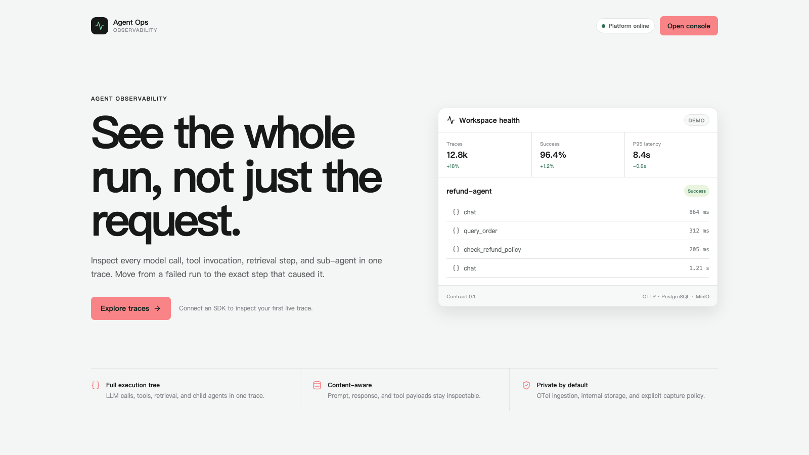
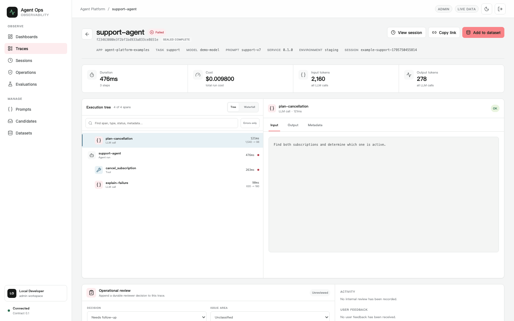
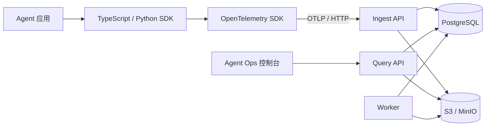

<div align="center">
  
</div>

<h1 align="center">Agent Ops</h1>

<p align="center">
  <strong>面向 AI Agent 的私有化可观测与评测平台。</strong><br />
  追踪每次运行，定位失败步骤，沉淀为数据集，<br />
  在下一次发布前验证改动。
</p>

<p align="center">
  <a href="README.md">English</a> ·
  <a href="#快速开始">快速开始</a> ·
  <a href="#架构">架构</a> ·
  <a href="#文档">文档</a>
</p>

<p align="center">
  <a href="https://github.com/DraskyChen/Agent-Ops/actions/workflows/ci.yml">
    
  </a>
  <a href="https://www.npmjs.com/package/agent-ops-otel-sdk">
    
  </a>
  <a href="https://pypi.org/project/agent-ops-otel-sdk/">
    
  </a>
  
  <a href="LICENSE">
    
  </a>
</p>

Agent Ops 把一次完整的 Agent 运行呈现为一条 Trace：模型调用、工具调用、
检索、规划和子 Agent 都在同一棵执行树中。你可以从失败或低质量的运行出发，
定位具体步骤，将其整理为数据集，发起评测，并在发布前比较版本回归。

```text
观测  →  审查  →  沉淀数据  →  评测  →  对比  →  改进
```

## 为什么选择 Agent Ops

**看到完整执行树，而不是彼此割裂的日志。** 从根 Agent 一直追踪到每次
LLM 调用、Tool 调用、检索和子 Agent，在同一上下文中查看耗时、Token、
成本、状态和错误。

**应用凭证与人的身份边界分开。** SDK 使用独立的机器凭证；控制台使用
OIDC、角色权限、显式内容查看权限、访问审计和保留策略。

**从生产问题闭环到回归测试。** 负反馈、未解决 Review、运行失败和评测失败
都能成为候选数据。创建不可变数据集修订，运行规则或 LLM Judge，并在同一
修订上比较两次运行。

**基于开放标准，也能完全私有化。** 两个 SDK 都基于官方 OpenTelemetry SDK，
通过 OTLP/HTTP 上报。PostgreSQL 是系统记录，MinIO 或任意兼容 S3 的对象
存储保存完整内容。

<div align="center">
  
  <sub>失败的 Tool 调用仍然和父 Agent、成本、Token、输入内容保持关联。</sub>
</div>

## 快速开始

### 环境要求

- Node.js 24+ 和 pnpm 12+
- Docker 与 Compose
- 仅在开发 Python SDK 时需要 Python 3.11+

```bash
git clone https://github.com/DraskyChen/Agent-Ops.git
cd Agent-Ops
cp .env.example .env

pnpm install
pnpm contracts:build
pnpm infra:up
pnpm db:migrate
pnpm metrics:backfill
pnpm dev
```

打开 [http://localhost:3000/console](http://localhost:3000/console)。本地开发
默认使用 `AGENT_OPS_AUTH_MODE=dev`，生产环境必须使用 OIDC。

如果 Docker 使用非默认 Context：

```bash
DOCKER_CONTEXT=orbstack pnpm infra:up
```

想立刻看到真实数据，可以运行内置示例：

```bash
pnpm examples:ts
# 或
pnpm examples:python
```

## 接入第一条 Trace

安装 TypeScript SDK：

```bash
npm install agent-ops-otel-sdk@0.1.0
```

```ts
import {
  configureTracing,
  shutdownTracing,
  withAgentRun,
  withLlmCall,
  withToolCall,
} from "agent-ops-otel-sdk";

await configureTracing({
  serviceName: "support-agent",
  serviceVersion: "1.4.0",
  appName: "customer-support",
  environment: "prod",
  endpoint: "https://agent-ops.example.com/v1/traces",
  headers: {
    authorization: `Bearer ${process.env.AGENT_OPS_INGEST_TOKEN}`,
  },
});

try {
  await withAgentRun(
    {
      sessionId: "session-123",
      taskType: "support",
      inputSummary: "Resolve a duplicate subscription",
    },
    async (run) => {
      await withLlmCall(
        {
          provider: "deepseek",
          requestModel: "deepseek-flash",
          inputTokens: 420,
          outputTokens: 80,
        },
        async () => "Call the subscription tool.",
      );

      await withToolCall(
        {
          name: "cancel_subscription",
          argsSummary: '{"subscriptionId":"sub-b"}',
        },
        async () => ({ cancelled: true }),
      );

      run.complete("success", "final_answer");
    },
  );
} finally {
  await shutdownTracing();
}
```

需要保存完整 Prompt 和响应时，设置 `contentCapture: "full"` 并提供
`contentToken`。成功、Tool 失败、检索、多 Agent 和 DeepSeek 的示例见
[examples](examples/README.md)。

## SDK

两个 SDK 使用相同的 `0.1` 遥测契约。

| 运行时 | 安装 | 导入名 | 发布地址 |
| --- | --- | --- | --- |
| TypeScript / Node.js 20+ | `npm install agent-ops-otel-sdk@0.1.0` | `agent-ops-otel-sdk` | [npm](https://www.npmjs.com/package/agent-ops-otel-sdk) |
| Python 3.11+ | `pip install agent-ops-otel-sdk==0.1.0` | `agent_ops` | [PyPI](https://pypi.org/project/agent-ops-otel-sdk/0.1.0/) |

npm 包仅支持 ESM。两个包都会在最低支持运行时上做 Smoke Test，并通过
`sdk-v*` GitHub 标签同步发布。

- [TypeScript SDK 指南](packages/sdk-typescript/README.md)
- [Python SDK 指南](packages/sdk-python/README.md)
- [SDK 发布与兼容性手册](docs/sdk-release.md)

## 功能范围

| 观测 | 改进 | 运维 |
| --- | --- | --- |
| Trace 搜索、执行树、Waterfall、Span 错误、Session | 候选数据发现与内部 Trace Review | OIDC 与 viewer / reviewer / admin 角色 |
| 数量、状态、成本、延迟和工具错误 Dashboard | 不可变数据集、规则评测和 DeepSeek LLM Judge | 内容权限、访问审计和过期清理 |
| 完整内容查看与可分享 Trace 链接 | 同一数据集上的双运行对比与逐用例差值 | PostgreSQL / MinIO 备份和恢复演练 |
| 带生命周期与审计记录的 Prompt Registry | 评测器模板与历史配置复用 | 单团队生产 Compose 与自动迁移 |

## 架构



首个部署是模块化单体，包含 `web`、`server` 和 `worker` 三个进程。
PostgreSQL 是初始系统记录；持久化边界允许在实测查询量需要时迁移 Trace
存储。Ingest 和 Query 保持独立模块，并拥有不同的信任边界。

设计决策和受约束的模块边界见[架构设计](docs/architecture.zh-CN.md)与
[代码架构](docs/code-architecture.zh-CN.md)。

### 生产 Compose

```bash
cp .env.production.example .env.production

pnpm release:config
pnpm release:build
pnpm release:up
```

`migrate` 服务会在 Server 和 Worker 之前运行。Web 默认监听
`http://127.0.0.1:8080`，MinIO 管理端只绑定本机 `9001`。部署前请阅读
[发布运行手册](docs/release-runbook.md)。

## 项目状态

Agent Ops 当前为 **0.1 alpha（预生产）**。从 Trace 到评测的核心纵向链路已经
实现，并使用真实 PostgreSQL 和 MinIO 依赖完成验证。

当前已具备：

- OTLP 接入、Trace 聚合、查询、内容存储和 TypeScript / Python SDK
- Dashboard、Trace / Session 查看、Review 和候选数据发现
- 数据集修订、规则与 LLM 评测、双运行对比和 Prompt Registry
- OIDC 角色、内容审计与保留、运维健康页和 Compose
- 已记录的单日 100 万 Span 数据库基线
- SHA-256 校验备份和已完成的开发环境真实恢复演练

正式生产验收前仍需完成：

- 目标环境中的容器构建与启动验收
- 30 天热数据和 OTLP 并发压测
- 正式 RPO / RTO、异地备份和上线验收

## 开发

```bash
pnpm check
pnpm test:integration
pnpm --filter @agent-ops/web build
```

`pnpm test:integration` 需要已迁移的开发环境，会用真实数据库验证筛选、
Feedback 幂等、Review、运维健康、过期内容审计、指标汇总和 Dashboard 查询。

容量与恢复命令：

```bash
CAPACITY_TEST_DATABASE_URL=... pnpm capacity:test
pnpm backup
CONFIRM_RESTORE=yes pnpm restore /path/to/agent-ops-snapshot
```

恢复会停止应用，并完整替换 PostgreSQL 和对象 Bucket。实测结果与生产要求见
[容量基线](docs/capacity.md)和[备份恢复演练](docs/backup-restore.md)。

## 文档

| 主题 | 文档 |
| --- | --- |
| 系统设计 | [架构设计](docs/architecture.zh-CN.md) |
| 模块边界 | [代码架构](docs/code-architecture.zh-CN.md) |
| 运行 SDK 示例 | [示例](examples/README.md) |
| 发布兼容 SDK | [SDK 发布](docs/sdk-release.md) |
| 单团队部署 | [发布运行手册](docs/release-runbook.md) |
| 查看容量证据 | [容量基线](docs/capacity.md) |
| 备份与恢复 | [备份恢复演练](docs/backup-restore.md) |
| 模型价格 | [模型定价](docs/pricing.md) |

## 许可证

Apache-2.0，见 [LICENSE](LICENSE)。
